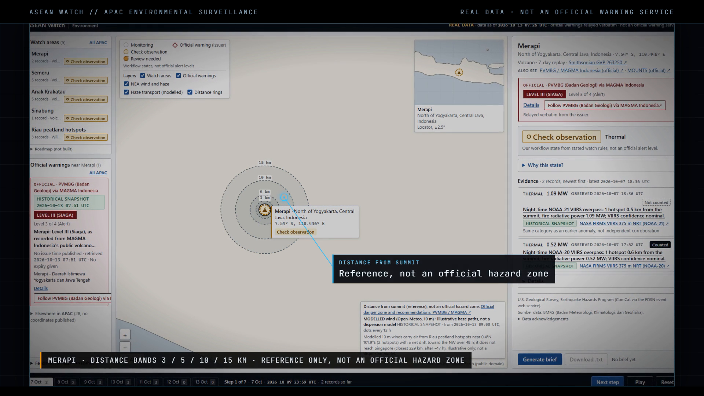

# ASEAN Watch

ASEAN Watch is an Asia-Pacific environmental surveillance prototype that uses real public data only. It does two separate jobs on one map. First, it watches five places in Indonesia (the Merapi, Semeru, Anak Krakatau and Sinabung volcanoes, and the Riau peatlands) using NASA FIRMS satellite hotspots and USGS and BMKG earthquake reports. It replays the last seven days one UTC day at a time and shows, record by record, why each watch area is in its current workflow state. Second, it relays official tsunami, earthquake, volcano and flood warnings word for word from the agencies with authority, so people know a potential evacuation may be coming and whose instructions to follow. It never issues a warning of its own. Everything on screen can be exported as a plain-text brief.

> **Not an official warning service.** This is a hackathon prototype. It does not issue warnings, alert levels or evacuation advice, and it does not predict eruptions, fires or floods. Official warnings are copied verbatim from the issuing agency with a link to it: **follow that agency's instructions**. If a feed is unavailable or lists nothing, that is **never an all-clear**; check the issuer directly. Satellite and earthquake data come from a snapshot that can be hours or days old, and the header shows its time. The workflow states (Monitoring, Check observation, Review needed) come from illustrative rules and are not official alert levels.

**Live site:** https://asean-watch.vercel.app

## Demo video (30 s)

[](https://github.com/jensonrajawali10/asean-watch/releases/download/demo-2026-10-13/asean-watch-demo-30s-v2.mp4)

[Watch or download the MP4](https://github.com/jensonrajawali10/asean-watch/releases/download/demo-2026-10-13/asean-watch-demo-30s-v2.mp4) (1920×1080, 20 MB) · [release notes](https://github.com/jensonrajawali10/asean-watch/releases/tag/demo-2026-10-13)

## Quick start

Requires Node.js 22.18 or later (24 recommended) and npm. Vitest 5 needs 22.12+, and `npm run refresh:warnings` imports a TypeScript module directly, which relies on Node's built-in type stripping (on by default from 22.18).

```bash
npm install
npm run dev              # development server; Vite prints the local URL
```

Refresh the data (needs internet):

```bash
npm run refresh:all      # FIRMS hotspots, USGS and BMKG quakes, official-warning and NEA snapshots
```

Build for presenting or offline use:

```bash
npm run build            # snapshots are bundled at build time, so rebuild after every refresh
npm run preview
```

Offline, the app runs entirely from the bundled snapshots. When it is online, the browser also fetches NEA and the official-warning feeds directly; each feed falls back to its snapshot if the request fails. FIRMS and earthquake data are only ever read from the snapshot.

| Command | What it does |
|---|---|
| `npm run refresh:data` | Downloads the four FIRMS 7-day South East Asia CSVs (about 26 MB in total), the USGS query and the three BMKG lists. It keeps rows near the watch areas and writes `data/real/*.json`. All or nothing: if any source fails, nothing is written. |
| `npm run refresh:warnings` | Captures the official-warning feeds to `data/warnings-snapshot.json`. If a feed fails, its previous entry is kept. |
| `npm run refresh:nea` | Captures NEA wind, PSI and PM2.5 to `data/nea-snapshot.json`. All or nothing. |
| `npm run refresh:all` | Runs the three scripts above in order. It stops at the first one that fails, so run the remaining ones yourself. |
| `npm test` | Unit tests for validation, watch rules, review states, warnings parsing, NEA, and the brief |
| `npm run typecheck` | TypeScript project check |
| `npm run build:region` | Regenerates `data/region.geojson` from Natural Earth via the installed `world-atlas` package |

The MAGMA Indonesia volcano levels are bundled records copied on 13 October 2026 (MAGMA's API needs a token). No refresh script updates them.

## Demo flow

1. **Overview.** The map shows the five watch areas with their workflow states, plus the official-warnings panel for the Asia-Pacific region. The header gives the snapshot time.
2. **Select Merapi and step through the week.** Next step reveals one real UTC day at a time, and the evidence accumulates. Play runs the remaining days; Reset returns to day 1.
3. **Why this state?** Shows the stated watch rules and why each record was or was not counted. The record inspector shows a record's source, observation time, ingestion time and quality note.
4. **Official and context layers.** The official MAGMA level for Merapi sits beside our state, in a separate style. Riau shows NEA Singapore wind and haze as context. The official-warnings panel relays issuer messages verbatim, for example a ThaiWater gauge on the Chao Phraya at "overflowing bank".
5. **Brief.** Generate brief, then Download .txt saves the brief for the current watch area and day.

The timed script is in [docs/DEMO_SCRIPT.md](docs/DEMO_SCRIPT.md).

## What the app shows

| Layer | Source | Mode label | Role |
|---|---|---|---|
| Satellite hotspots | NASA FIRMS VIIRS 375 m (Suomi NPP, NOAA-20, NOAA-21) and MODIS 1 km | HISTORICAL SNAPSHOT | Evidence, category `thermal` |
| Earthquakes | USGS ComCat; BMKG Data Terbuka and InaTEWS lists | HISTORICAL SNAPSHOT | Evidence, category `seismic` |
| Volcano identity and summit points | Smithsonian Global Volcanism Program | Catalog | Watch-area centres |
| Workflow state | Stated watch rules in `src/lib/watchRules.ts` | Derived | Analyst prompt, not an alert level |
| Official warnings | BMKG, JMA, GeoNet, US NWS, ThaiWater, Jakarta DSDA, PUB Singapore | LIVE if fetched this session, else HISTORICAL | Relayed verbatim; never changes a workflow state |
| Volcano levels | PVMBG via MAGMA Indonesia (Merapi, Semeru, Anak Krakatau, Sinabung at Level III) | HISTORICAL, recorded 2026-10-13 06:52 UTC | Relayed verbatim beside the watch, linked to MAGMA |
| Impact estimates | GDACS | LIVE or HISTORICAL | Aggregator; labelled as an estimate, not a warning |
| Wind and haze | NEA Singapore via data.gov.sg | LIVE or HISTORICAL SNAPSHOT | Context only; shown for Riau (within 600 km of Singapore) |
| Volcanic gas, deformation, ash | none open and keyless | Not shown | Each volcano links to MOUNTS instead |
| Modelled weather or air quality | none | Not used | |

**Current result.** In the snapshot retrieved 2026-10-13 07:26 UTC (7 to 13 October), every watch area reads **Check observation** on every day, from thermal evidence alone (records accumulate across the week, so an early hotspot keeps counting). No USGS or BMKG earthquake fell within range of any watch area, and there is no open SO2 feed, so no second evidence category exists and no watch area reaches Review needed. Nothing is staged. A refresh can change this result.

## Architecture

There is no server, database or model API. Data flow:

```
refresh scripts → data/real/*.json, data/watches.json (snapshot, bundled at build)
  → loadFixtures: watch rules turn rows into observations → validateObservations
  → visibleObservations(watch, day) → deriveReview → map, rail, review column, timeline
  → buildBriefing → .txt download

loadOfficialWarnings (live per feed → cache → bundled snapshot) → warningsNear → panel, map, brief
loadNeaContext (live → bundled snapshot) → assessDrift → context card, map overlay, brief
```

Official warnings and NEA context never enter `deriveReview`. The app component owns the selected watch area, the replay day and the generated brief. Changing the area or the day clears the brief.

| File or module | Responsibility |
|---|---|
| `src/types.ts` | Shared data contract |
| `data/watches.json` | The five watch areas: centre, summit radius or haze box, reference links |
| `data/volcanoes.json` | Smithsonian GVP catalog entries for the four volcanoes |
| `data/real/firms.json`, `quakes.json`, `meta.json` | The snapshot: kept rows, and per-source URL, retrieval time, Last-Modified, row counts and attribution |
| `data/warnings-snapshot.json`, `data/nea-snapshot.json` | Raw official-warning and NEA payloads, used as offline fallbacks |
| `data/SOURCES.md` | Provenance, field mapping and caveats for the snapshot |
| `scripts/refresh-data.mjs`, `capture-warnings-snapshot.mjs`, `capture-nea-snapshot.mjs` | Download and write the snapshots |
| `src/lib/watchRules.ts` | Stated watch rules: turn raw rows into observations and set `anomaly` with the rule text |
| `src/lib/fixtures.ts` | Load the snapshot, build seven replay days, validate records |
| `src/lib/reviewRules.ts` | Validation, records visible on a day, workflow state, and a reason for each record |
| `src/lib/warnings.ts` | Official-warning feeds: parse verbatim, track feed status, fall back to the snapshot, filter by distance |
| `src/lib/nea.ts` | NEA wind and haze: fetch, normalise to UTC, fall back to the snapshot, illustrative drift |
| `src/lib/briefing.ts` | Plain-text brief, file name, browser download |
| `src/components/*`, `src/App.tsx` | Header, watch-area rail, official-warnings panel, map, review column, record inspector, replay timeline, brief panel |
| `scripts/build-region.mjs`, `data/region.geojson` | Bundled country boundaries |

## Watch rules and workflow states

These illustrative watch rules mark a record as an anomaly. They are not official thresholds:

- **Thermal, volcano:** a FIRMS hotspot within 5 km of the GVP summit point, with VIIRS confidence nominal or high, or MODIS confidence 50 or more.
- **Thermal, haze box:** 10 or more confident hotspots from one sensor on one UTC day inside the Riau box.
- **Seismic:** a USGS or BMKG earthquake of M 3.0 or more within 30 km of the summit, or inside the box. USGS and BMKG reports of the same event are both shown and never merged.

The workflow state counts distinct evidence categories among the flagged records visible up to the current day. None gives **Monitoring**, one gives **Check observation**, and two or more give **Review needed**. A repeat from the same category is shown but not counted as independent corroboration. These states tell an analyst where to look. They say nothing about the likelihood of an eruption or a fire, and they are never worded as "evacuate".

## Official warnings relay

- Issuer, level, headline, area, times and any instruction are shown verbatim, with "Follow <issuer>" linking to the issuer's page. Fixed, reviewed glosses explain unfamiliar scales: for example, DSDA's Siaga 1 is its most severe level, not its least.
- Levels are never re-scored, merged, translated on the fly, or restyled as workflow states. Official items have their own style.
- A failed feed reads "Official feed unavailable: check <issuer> directly". An empty list says it is not an all-clear. Expired or ended messages are labelled.
- GDACS is an aggregator. Its items are labelled as impact estimates, not warnings.

## Data and attribution

NASA FIRMS (LANCE/ESDIS) hotspots; U.S. Geological Survey earthquakes (public domain); "Sumber data: BMKG" (required by BMKG's terms); Smithsonian Institution Global Volcanism Program catalog; PVMBG/MAGMA Indonesia levels (all rights reserved by MAGMA; recorded and linked, not redistributed in bulk); JMA (Public Data License v1.0); GeoNet (CC BY 3.0 NZ); US National Weather Service; GDACS; ThaiWater (Hydro-Informatics Institute, RID gauges); Dinas Sumber Daya Air DKI Jakarta; PUB and NEA via data.gov.sg (Singapore Open Data Licence v1.0); Natural Earth boundaries (public domain) via `world-atlas`. The full attribution texts are in `data/SOURCES.md` and [docs/DATA_AND_LIMITATIONS.md](docs/DATA_AND_LIMITATIONS.md).

## Documentation

- [docs/DEMO_SCRIPT.md](docs/DEMO_SCRIPT.md): four-minute script, pre-demo checklist, backup procedure, judging Q&A
- [docs/DATA_AND_LIMITATIONS.md](docs/DATA_AND_LIMITATIONS.md): sources, watch rules, the warnings relay, label policy, limitations, references
- [docs/ROADMAP.md](docs/ROADMAP.md): what exists per hazard, and what comes next
- [docs/CONTRACT.md](docs/CONTRACT.md), [docs/DESIGN.md](docs/DESIGN.md), [data/SOURCES.md](data/SOURCES.md): implementation contract, UI design, data provenance
